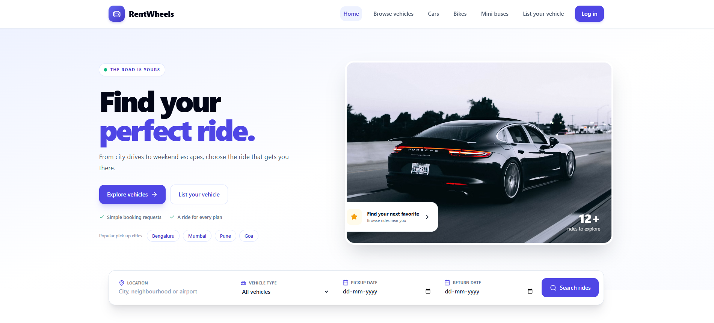

# RentWheels

RentWheels is a responsive vehicle rental marketplace for exploring and managing vehicle rentals. Customers can find rides, save favorites, and manage booking requests; Owners can list vehicles and handle rental requests; Admins can review marketplace listings, bookings, and users.



## Features

- Start on the marketplace home page when signed out
- Browse, search, and filter vehicles by category, location, price, and availability
- View vehicle details and save favorite vehicles
- Switch between Customer, Owner, and Admin demo roles while signed in
- Use role-specific dashboards to manage trips, listings, booking requests, and marketplace content
- Log out to return to the home page
- Create, edit, and delete vehicle listings
- Upload 3 to 6 photos for a listing; photos are resized in the browser
- Validate listing and booking forms before continuing
- Preserve a valid guest listing or booking form while signing in, then return to the form
- Use responsive layouts styled with Tailwind CSS

## Tech stack

- Next.js App Router
- React 19
- Tailwind CSS
- Lucide React icons

## Next.js concepts used

- **App Router and file-based routing:** `app/[[...slug]]/page.jsx` uses an optional catch-all route to accept paths such as `/`, `/vehicles`, `/vehicles/:id`, and role dashboards.
- **Route and query parameters:** The async route page reads Next.js `params` and `searchParams`, then passes the path and query string to the marketplace for screen selection and filtering.
- **Server and Client Components:** The route page and root layout run as Server Components by default. `src/Marketplace.jsx` and interactive screens are Client Components because they use React state and effects, browser storage, and form interactions.
- **Root layout and metadata:** `app/layout.jsx` defines the shared HTML document, imports global styles, and exports page metadata for the application.
- **Global styling:** `app/globals.css` loads Tailwind layers and defines shared base styles used across routes.

## Prerequisites

- Node.js 20.9 or later
- npm

## Getting started

1. Clone the repository and move into the project directory:

   ```bash
   git clone https://github.com/chiranjeevi-bhupathiraju/next-app-rent-wheels.git
   cd next-app-rent-wheels
   ```

2. Install dependencies:

   ```bash
   npm install
   ```

3. Start the development server:

   ```bash
   npm run dev
   ```

   Open [http://localhost:3000](http://localhost:3000) in your browser.

## Using the app

### Browse and book a vehicle

1. Browse vehicles from the home page or select **Browse vehicles**.
2. Search or filter listings, then open a vehicle to view its details.
3. Enter pickup and return dates, your name, and a valid phone number. Notes are optional.
4. Select **Request booking**. The form validates the dates and required contact details before continuing.
5. If signed out, enter a valid email and nonblank password on the demo login page. You will return to the booking form with your details preserved. A valid request is then saved as a demo booking.

### List a vehicle

1. Select **List your vehicle** and fill out the listing form.
2. Enter the required vehicle details and upload at least 3 photos (up to 6).
3. Select **Add vehicle**. The form validates required fields, daily price, category, and photo count before continuing.
4. If signed out, sign in on the demo login page. You will return to the listing form with your draft preserved. After adding the vehicle, the form is cleared.

### Demo roles

- **Customer:** Browse rides and view the customer dashboard.
- **Owner:** Add and manage vehicle listings and review booking requests.
- **Admin:** Review demo users, vehicle listings, and bookings.

The login page accepts any syntactically valid email address and any nonblank password; it does not verify credentials with a server. When signed in, use the role menu to switch directly between demo roles. Use **Log out** to clear the current role and return to the home page.

## Data and limitations

Marketplace data and the current role are stored in browser `localStorage`. Unfinished listing and booking form drafts are kept in `sessionStorage` so they can be restored after the login redirect in the same browser tab. Clearing browser storage removes the saved demo data.

This project does not provide real accounts, server-side data storage, reservations, or payments. Booking requests are local demo records and should not be treated as confirmed rentals.

## Possible future improvements

- Add a backend API and database for shared users, vehicles, favorites, and bookings.
- Implement secure authentication, account management, and server-side role permissions.
- Track vehicle availability by date and prevent overlapping booking requests.
- Add booking status notifications and owner-customer messaging.
- Store uploaded vehicle photos in cloud storage and support image management.
- Integrate a payment provider for deposits and rental payments.
- Add automated unit, integration, and end-to-end tests.
- Improve accessibility and add more language and currency options.

## Available scripts

### `npm run dev`

Starts the Next.js development server with live reloading.

### `npm run build`

Creates an optimized production build.

### `npm start`

Starts the production server. Run `npm run build` first.

## Project structure

```text
app/
  [[...slug]]/page.jsx   Catch-all route entry point
  globals.css            Global styles and Tailwind directives
  layout.jsx             Root app layout
src/
  components/            Shared UI, vehicle editor, cards, and tables
  screens/               Home, browse, login, dashboards, and vehicle detail views
  data.js                Seed demo vehicles and categories
  Marketplace.jsx        Route selection and marketplace state
  store.js               Browser localStorage helpers and demo data setup
  utils.js               Formatting, image, and date utilities
```
